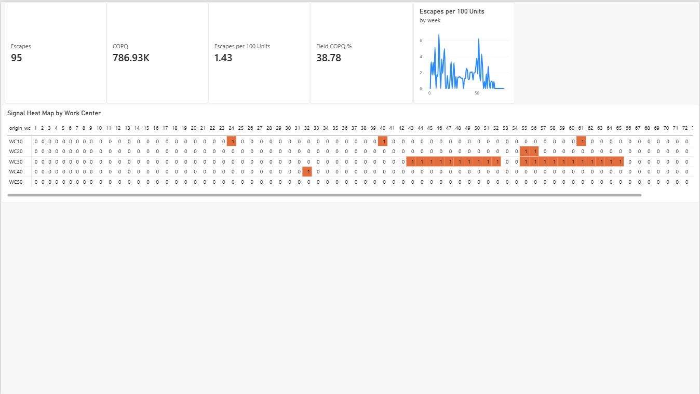
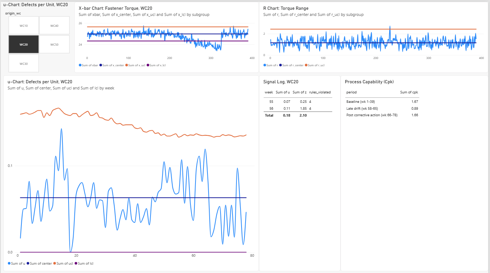
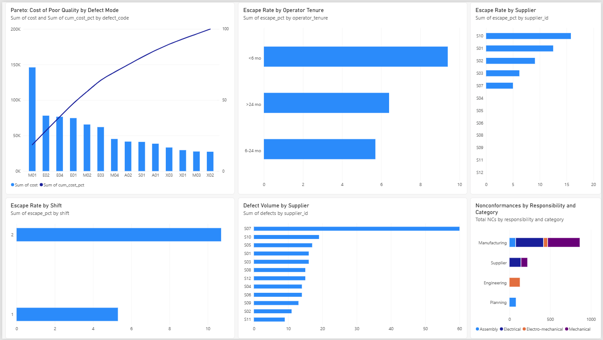

# Escape Risk Early Warning: SPC-driven nonconformance analysis

**All data in this repository is synthetic.** It was generated by `generate_data.py` to
simulate an electro-mechanical assembly line. No real program, company, supplier, or
part data is represented. The scenario is modeled on publicly reported quality
concerns in defense aerospace production (see Background), not on any internal data.





## Quick start

```
pip install pandas numpy
python generate_data.py     # writes data/*.csv  (seed 42, reproducible)
python spc_analysis.py      # writes output/*.csv and prints headline metrics
```

Load `output/*.csv` and `data/*.csv` into Power BI or Excel for the dashboard.

## Files

| File | Purpose |
|---|---|
| `data/nonconformances.csv` | One row per nonconformance: work center, defect code, category, responsibility, supplier, operator tenure, shift, detection point, disposition, labor hours, cost |
| `data/weekly_production.csv` | Units built per week and new-operator share at WC30 |
| `data/torque_measurements.csv` | Fastener torque readings, 5 per daily subgroup, for the X-bar/R chart |
| `output/spc_u_chart.csv` | u-chart per work center by build week with frozen Phase I limits and Western Electric rule flags |
| `output/spc_torque_xbar_r.csv` | X-bar and R chart values and rule flags |
| `output/torque_capability.csv` | Cpk before, during, and after the torque drift |
| `output/pareto.csv` | Defect modes ranked by cost of poor quality |
| `output/strat_*.csv` | Escape rate stratified by operator tenure, shift, supplier |

## Injected ground truth (for validating the analysis)

| Signal | Where | When | Detected by |
|---|---|---|---|
| Torque tool drift (mean falls 25.0 to 23.6 N·m) | WC20, defect M01 | Weeks 40 to 65, recalibrated week 66 | X-bar chart: first rule violation week 46, sustained by week 48. u-chart: week 55. First field escape reported: week 65 |
| Workforce turnover during ramp (new-operator share 12% to 45%) | WC30 | Weeks 30 to 55 | u-chart: sustained signal weeks 43 to 56 |
| Bad connector lots from supplier S07 | E04, WC30 | Weeks 55 to 60 | Supplier stratification: S07 = 60 of 218 supplier-attributed defects |
| Weaker final inspection on second shift | All | Always | Shift stratification: 10.7% escape rate vs 5.3% on first shift |

Known false alarms are left in deliberately (7 pre-drift subgroups on the X-bar chart,
4 weeks at WC10) so the writeup can discuss Western Electric rule false-alarm rates
and why signals are confirmed before opening a corrective action.

## Method notes

- u chart (defects per unit) because subgroup size (units built per week) varies and a
  unit can carry more than one defect. Phase I baseline is weeks 1 to 25; limits are
  frozen and applied to Phase II so a drifting process cannot inflate its own limits.
- X-bar/R on torque, n=5, A2=0.577, D4=2.114. Cpk against a 22.5 to 27.5 N·m spec.
- Western Electric rules 1 to 4 evaluated on standardized values so they work with
  variable subgroup size.
- Pareto ranks by cost, not count, because field escapes cost roughly ten times an
  in-process catch and count-based Pareto would understate them.
- 8D on the top Pareto item (M01 fastener under-torque) is in `8D_M01.md`.

## Background (public sources)

- DoD Office of Inspector General, [*Audit of the DoD's Oversight of Contractor
  Performance for the F-35 Joint Strike Fighter Sustainment Contracts*](https://media.defense.gov/2025/Dec/23/2003848755/-1/-1/1/DODIG-2026-039_FINAL%20SECURE.PDF)
  (Report No. DODIG-2026-039, Dec. 23, 2025): average F-35 fleet availability
  was about 50 percent in FY2024, and the audit found the Joint Program Office
  did not use Contracting Officer Representatives effectively or enforce
  contract oversight requirements.
- GAO, [*F-35 Joint Strike Fighter: Program Continues to Encounter Production
  Issues and Modernization Delays*](https://www.gao.gov/assets/gao-24-106909.pdf)
  (GAO-24-106909, May 2024): Lockheed Martin has missed its own goals for
  scrap, rework, and repair hours, and several suppliers have had late or
  quality-impacted deliveries.

This project simulates a version of that second problem, catching scrap/rework-driving
defects before they reach the field, at a scale a self-taught candidate can
build end to end. The workforce-turnover and connector-supplier scenarios in
this dataset are illustrative simulations, not claims about any specific
documented event.
